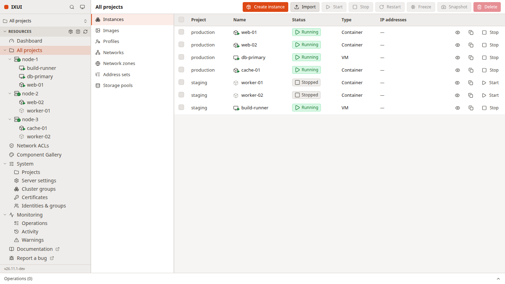
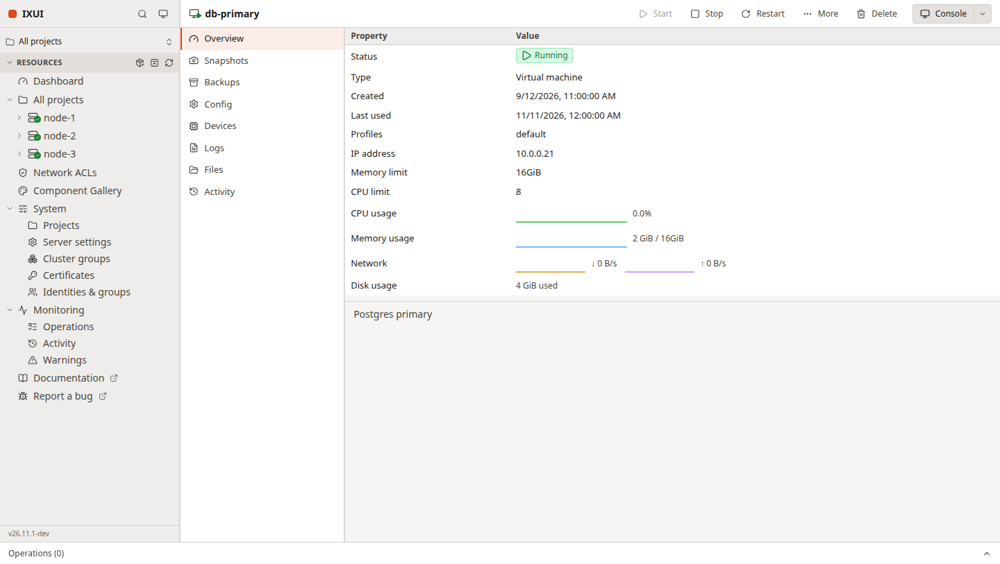
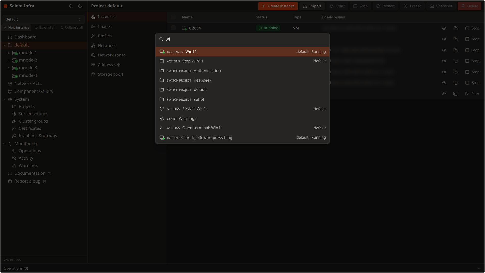

# IXUI — a web interface for Incus

[](https://github.com/xlmnxp/ixui/actions/workflows/ci.yml)
[](https://github.com/xlmnxp/ixui/releases)
[](LICENSE)

> [!WARNING]
> **Pre-alpha.** IXUI is early software — expect missing features, rough edges and
> breaking changes. Do not point it at a production cluster you are not prepared
> to re-create.

IXUI is a web UI for [Incus](https://linuxcontainers.org/incus/): a single-page
React app that talks straight to incusd over its REST API and event stream. It is
built on a hand-written component system — no component library, no CSS
framework beyond Tailwind utilities — so the whole surface is ours to shape.



<table>
<tr>
<td width="50%"></td>
<td width="50%"></td>
</tr>
<tr>
<td align="center"><em>Instance overview — live metrics and health</em></td>
<td align="center"><em>Command palette — Ctrl/Cmd+K for anything</em></td>
</tr>
</table>

*Screenshots use demo data.*

## Why another UI

- **Cluster-first.** The sidebar is a real tree: cluster members, their instances,
  the project selector and the system/monitoring pages — not a flat table bolted
  onto a cluster API.
- **Fast to operate.** Bulk start/stop/restart/freeze/snapshot/delete, per-instance
  context menus, a command palette and keyboard-navigable dialogs.
- **Honest state.** Operations show live progress (download percentage, unpack
  stage), the task bar keeps running work visible, and editors warn before you
  throw away unsaved changes.
- **Light and dark, remembered.** System/dark/light theme, remembered split
  position and table sorting, and a drawer layout on narrow screens.
- **Small dependency surface.** `lucide-react` for icons is the only UI dependency;
  everything else is React, TypeScript and Tailwind tokens.

## Features

**Instances**
- Create wizard: simplestreams catalog or cached images, profile selection,
  memory/CPU limits, network, target cluster member.
- Detail view with Overview (live CPU/memory/network/disk sparklines), Snapshots,
  Backups, Config, Devices, Logs, Files and per-instance Activity.
- Lifecycle actions (start, stop, restart, freeze), rename, copy, move across
  projects and members (optionally live), delete, backup export download, and a VM
  console thumbnail.
- Automatic snapshots: an editor for `snapshots.schedule` / `snapshots.expiry` with
  an enable switch.
- Backups: create (instance-only or optimised), download, delete; import an
  instance from an uploaded backup archive.

**Files and terminal**
- File explorer with back/forward history, a path bar, in-place text editing,
  upload, download, create folder and delete.
- Popup shell terminal per instance, plus a SPICE (VGA) console for VMs with
  fit-to-window scaling.

**Infrastructure**
- Images: local list, pull from simplestreams remotes, alias management.
- Networks: create/delete, forwards, load balancers, and peers on OVN networks;
  network zones and address sets in their own tabs.
- Network ACLs: project-scoped rules with a large rule editor (ingress/egress,
  action dropdown, protocol presets, logging and state indicators).
- Storage: pools, custom volumes (create, rename, resize, snapshots, attach), ISO
  import, and buckets with an object-store friendly driver list.
- Profiles and projects: full CRUD, project usage against real limits, and
  stepped editors.
- Cluster: member overview and capacity, evacuate/restore, join tokens, cluster
  groups, failure domains and member editing.

**Everything else**
- Authentication via TLS client certificate or OIDC, including the
  `user.ui.sso_only` redirect mode and `user.ui.title` branding.
- Realtime updates from the Incus event websocket, with automatic reconnects.
- Operations and activity logs, warnings, a persistent task bar with live progress,
  and cancellation.
- Identities and auth groups (OpenFGA), certificates, and server settings.
- Accessibility: focus-trapped dialogs, keyboard-navigable tree and tabs, axe
  checks in the test suite.
- A component gallery at `/ui/gallery` showing every primitive and its states.

## Quick start

Requirements: Node 20+, and an incusd you can reach (defaults to
`https://127.0.0.1:8443`).

```bash
git clone https://github.com/xlmnxp/ixui.git
cd ixui
npm install

# client certificate for the dev proxy
incus list >/dev/null 2>&1 || incus remote add local https://127.0.0.1:8443

npm run dev
```

Open <http://localhost:5173/ui/>. The Vite plugin proxies `/1.0`, the event
websocket, `/oidc` and `/documentation` to incusd using the client certificate in
`~/.config/incus/`. Point it elsewhere with environment variables:

```bash
INCUS_TARGET=https://incus.example.com:8443 INCUS_CERT_DIR=~/.config/incus npm run dev
```

## Deploy

```bash
npm run build   # type-check + bundle into dist/
sudo cp -r dist/* /usr/share/incus/ui/   # confirm the path on your distro
sudo systemctl restart incus
```

Then browse to `https://your-host:8443/ui/`. Authentication is automatic when the
browser has a trusted client certificate, or through OIDC when configured.

### Server options the UI reads

| Key | Effect |
| --- | --- |
| `user.ui.title` | Name shown in the sidebar and window title |
| `user.ui.sso_only` | `true` skips the local login screen and redirects to OIDC |
| `metadata.enabled` | `true` exposes config-key descriptions in editors |

```bash
incus config set user.ui.title "Acme Cloud"
incus config set metadata.enabled true
```

## Project layout

```
src/
  api/          typed Incus REST client, event stream, endpoint modules
  components/   hand-written primitives (Dialog, Window, Table, Tree, …)
  lib/          small helpers: paths, formatting, guards, operation progress
  pages/        route-level screens, one folder per instance tab
  shell/        layout, sidebar tree, command palette, task bar, context menus
  state/        tiny external stores consumed through useSyncExternalStore
  styles/       design tokens (@theme) and the two theme variants
scripts/        conventional-commit release tooling
plugins/        Vite dev proxy for incusd (HTTP + websocket)
```

## Development

```bash
npm run dev        # Vite dev server with the Incus proxy
npm run build      # type-check then bundle
npm test           # vitest unit + component tests
npm run typecheck  # tsc --noEmit
npm run lint       # eslint, zero warnings allowed
```

Design tokens live in `src/styles/theme.css`; every component in
`src/components/` ships with tests. The gallery at `/ui/gallery` renders each one
with its variants and states.

## Releases

Releases are automatic. Commit messages follow
[Conventional Commits](https://www.conventionalcommits.org/); `feat`, `fix`,
`perf` and breaking changes trigger a release with a tag, an updated
`CHANGELOG.md`, and a GitHub release carrying `ixui-<version>.zip` (the built
`dist/`) plus its checksum. Versions are year-month based (`YY.M.N`), and the
running app shows its version at the bottom of the sidebar.

## AI-assisted development

IXUI is built with substantial help from AI coding tools. Contributions are
human-reviewed and covered by the test suite, but given the pre-alpha state,
apply the usual scrutiny before trusting it with your clusters. Bug reports and
pull requests are very welcome.

## License

Copyright 2026 Salem Alsaiari. Licensed under the
[Apache License 2.0](LICENSE).
